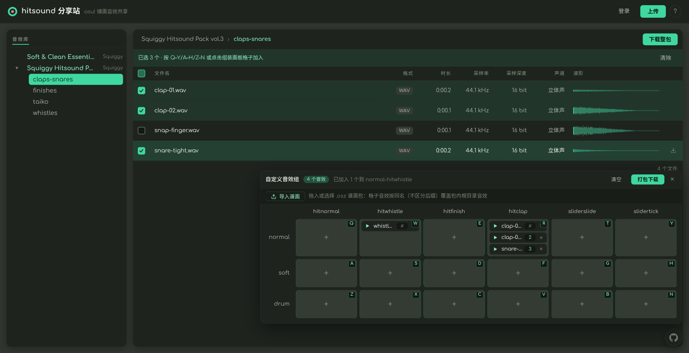
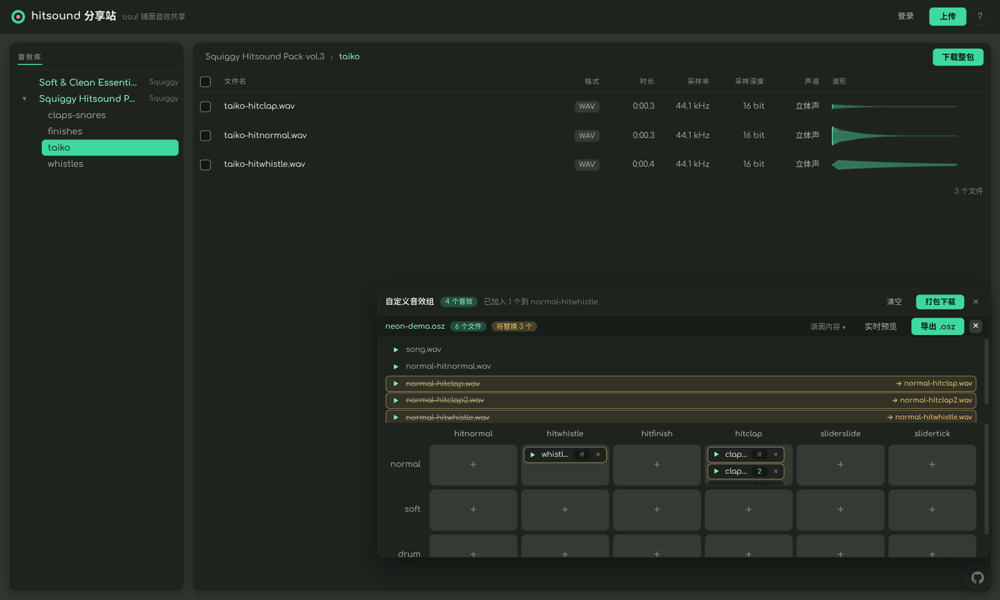
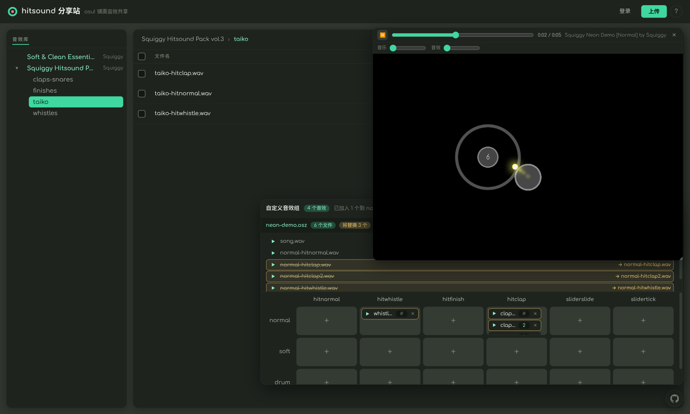

# 🥁 hitsound-share

**给 osu! mapper 的音效工作台——找音效、组音效、试音效，别再翻文件夹了。**

找一套顺手的 hitsound 要开 N 个网盘帖子，试音效要一个个下载，组一套要手工改名几十个 wav——
这些活，现在全部在浏览器里点几下就能完成。

## 三步，从一堆 wav 到能开打的谱面

### 1️⃣ 找——边听边挑，像在本地音频管理器里一样顺手

每个音效自带波形图，点哪播哪；格式、时长、采样率、声道一目了然。
免登录、不注册、不限速——打开网页就能开始挑。音效包的文件夹结构原样搬进浏览器，熟悉的 taiko、claps-snares 直接对着找。

### 2️⃣ 组——组装面板自动搞定 osu! 命名规则

勾选几个音效，按一下键盘（QWERTY / ASDFGH / ZXCVBN 就在你手边），全部落进
`normal / soft / drum × hitnormal / hitwhistle / hitfinish / hitclap` 的格子。
同格自动连续编号、按 osu! 皮肤命名——`normal-hitclap.wav`、`normal-hitclap2.wav`，导出即用，一个文件名都不用你改。

### 3️⃣ 试——导入谱面，改完即听

把本地 .osz 拖进来：格子里的音效按文件名匹配谱面根目录音效，**将替换哪些条目琥珀色高亮**，替换了什么清清楚楚——
谱面集全程只存在于浏览器内存，不上传、不入库。
点「实时预览」，内嵌的 osu!cad 自动开打你的谱面，格子里的任何改动实时生效、热刷新不打断播放。
**边调边听，改完即所得，不用反复进出游戏。**

## 顺手还帮你做了这些

- **整包下载 = 永远新鲜**：zip 由你的浏览器按包的**当前内容**实时打包——下载到的一定是此刻的站内状态，不存在「下到旧版」
- **社区共享越传越省**：内容寻址去重（sha256），每个音效全站只存一份；别人传过的音效你上传时**自动秒传**
- **一个压缩包就能上架**：拖入 zip / rar / 7z，解包、哈希、校验全在浏览器本地完成；上架后随时附加上传、在线改名、批量整理
- **不止是网页**：前端可独立部署到任意域名，或打包成桌面客户端（Tauri，Linux deb）——连的是同一个 API，登录态经系统浏览器完成
- **需要私域？**：站点访问密码门、管理员体系、上传配额（单文件 ≤10MB / 每日 5 包 / 存储水位）都是可选项，管理员可在线维护

## 为什么它能整个塞进 Cloudflare 免费计划

服务端只做清单、核验与代理回退——解包（rar / 7z 走按需加载的 wasm）、去重哈希、zip 组装、谱面合并，重活全部在浏览器里干。
音频按内容寻址存进 R2，引用计数账本自动回收没人引用的空间。
**结果：没有服务器的重型计算，中小社区规模的音效站可以零成本跑着。**

## 谁适合用

| 你是 | 你会得到 |
| --- | --- |
| **mapper** | 试音、下音、组专属 hitsound 组、套进谱面实时预览，一条龙 |
| **音效作者** | 一个压缩包上架作品，社区内秒传播、免重复上传 |
| **玩家** | 挑一套顺手的 hitsound，下载即用 |
| **团队 / 社区** | 自托管一个私域音效库，密码门控制访问，素材与成员都自己掌握 |

## 自行托管（推荐，十来分钟上线）

考虑到音效素材的版权归属，我们自建的实例不对公众开放——但本项目从第一天起就按「fork 即可私有部署」设计：

1. **版权可控**：分发范围掌握在自己手里
2. **成本可控**：Pages Functions + R2 + D1 免费额度内运行，中小社区规模零成本
3. **数据自主**：全部资源都在你自己的 Cloudflare 账号下，随时可迁走

快速步骤（完整细节与验证清单见 [docs/deployment.md](docs/deployment.md)）：

1. Fork 或导入本仓库，创建 D1 数据库与 R2 桶
2. 创建 Cloudflare Pages 项目并连接仓库，配置 R2 CORS
3. 在 osu! 网站创建 OAuth 应用，把 6 个上传链路变量配进 Pages
4. 远程执行一次 `schema.sql` 初始化数据库
5. 推送 `main`，自动构建部署完成

> 只想要纯浏览的只读音效站？上传相关变量不配齐即可——上传入口自动隐藏，浏览 / 试听 / 下载照常工作。
> 想把前端部署到独立域名或打包桌面客户端？后端配一个 `CORS_ORIGINS` 白名单就行，见 [docs/architecture-split.md](docs/architecture-split.md) 与 [docs/desktop.md](docs/desktop.md)。

## 开发者

SvelteKit 5 + Cloudflare Pages（Functions）+ R2 + D1。领域术语见 [CONTEXT.md](CONTEXT.md)，架构决策见 [docs/adr/](docs/adr/)，协作约定见 [AGENTS.md](AGENTS.md)。
常用命令封装在 [justfile](justfile)：`just setup` 一键初始化本地环境，`just verify` 跑提交前门禁（单测 + 构建）。

## License

[MIT](LICENSE)
